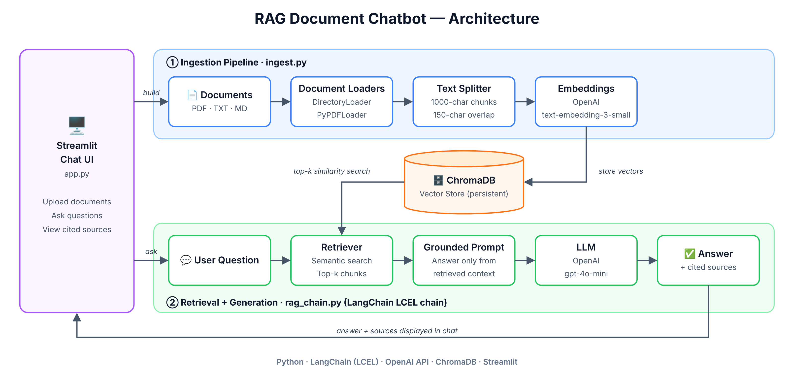

# 📚 RAG Document Chatbot

## Tech Stack

`Python` · `LangChain` · `LCEL` · `OpenAI API` · `GPT-4o-mini` · `OpenAI Embeddings` · `ChromaDB` · `Vector Database` · `Semantic Search` · `RAG` · `Prompt Engineering` · `Streamlit` · `PyPDF` · `Dev Containers`

| Layer | Tools |
|---|---|
| **Language** | Python |
| **LLM framework** | LangChain (LangChain Expression Language / LCEL) |
| **LLM** | OpenAI `gpt-4o-mini` |
| **Embeddings** | OpenAI `text-embedding-3-small` |
| **Vector database** | ChromaDB (persistent, local) |
| **Frontend** | Streamlit |
| **Document parsing** | PyPDF, LangChain document loaders |
| **Dev environment** | Dev Container / GitHub Codespaces |

---

## About the project

I built this chatbot so you can ask questions about your own documents in plain English and get answers that come straight from those documents, with the sources shown alongside.

It's a **Retrieval-Augmented Generation (RAG)** application. You give it a set of PDFs, text files or Markdown files. It indexes them into a **vector database**, and when you ask a question it finds the most relevant passages and has an **LLM** answer using only those passages. If the answer isn't in the documents, it says so instead of making something up.

My goal was to build the full RAG pipeline end to end, from ingestion through retrieval to grounded generation, in a way that's modular, easy to run, and transparent about where every answer comes from.

---

## Architecture Diagram


### How it works

1. **Ingest.** I load the documents and split them into small, overlapping chunks. Each chunk is turned into an **embedding**, a list of numbers that represents its meaning, and stored in **ChromaDB**.
2. **Retrieve.** When a question comes in, it's embedded the same way, and a **semantic search** pulls the chunks closest in meaning, even if the wording doesn't match exactly.
3. **Generate.** The retrieved chunks go into a prompt that tells the model to answer **only from that context** and to say it doesn't know when the answer isn't there.
4. **Show sources.** Every answer is displayed with the passages it was based on, so you can check it against the original text.

---

## LangChain components I used

| Component | What I used it for | File |
|---|---|---|
| `DirectoryLoader`, `TextLoader`, `PyPDFLoader` | Loading documents from a folder | `ingest.py` |
| `RecursiveCharacterTextSplitter` | Splitting text at natural boundaries (paragraph → sentence → word) | `ingest.py` |
| `OpenAIEmbeddings` | Converting text into vectors | `ingest.py`, `rag_chain.py` |
| `Chroma` (`langchain-chroma`) | Storing and searching vectors | `ingest.py`, `rag_chain.py` |
| `as_retriever()` | Top-k semantic similarity retrieval | `rag_chain.py` |
| `ChatPromptTemplate` | The grounding system prompt + user question | `rag_chain.py` |
| `ChatOpenAI` | Calling `gpt-4o-mini` at temperature 0 | `rag_chain.py` |
| `RunnablePassthrough`, `StrOutputParser`, LCEL `\|` | Chaining retrieval → prompt → LLM → output | `rag_chain.py` |

---

## Features

- **Bring your own documents:** upload PDFs, `.txt` or `.md` files in the browser, or start with the sample documents I included.
- **Grounded answers:** the prompt keeps the model inside the source material, which cuts down on **hallucination**.
- **Source citations:** every answer shows which document and passage it came from.
- **Adjustable retrieval:** a slider sets how many chunks (`k`) are pulled per question.
- **Web app and CLI:** use the Streamlit app, or run the pipeline from the command line to test it quickly.
- **Modular code:** ingestion, RAG logic and UI are separate modules, so the RAG chain can be reused behind an API or a different interface.

For a walkthrough with real questions and answers, including a hallucination check, see [`EXAMPLE.md`](EXAMPLE.md).

---

## Getting started

```bash
git clone https://github.com/parthd06/rag-doc-bot.git
cd rag-doc-bot
python -m venv venv
source venv/bin/activate        # Windows: venv\Scripts\activate
pip install -r requirements.txt
```

Add a `.env` file in the project root:

```
OPENAI_API_KEY=sk-your-key-here
```

> 💡 The repo also includes a Dev Container, so you can open it in **GitHub Codespaces** and skip local setup.

### Run the Streamlit app

```bash
streamlit run app.py
```

Click **"Build / Rebuild Vector Store"** in the sidebar, then try questions like:

- *"How many PTO days do employees get?"*
- *"What's the API rate limit on the Business tier?"*
- *"What happens if uptime falls below the SLA?"*

### Or use the command line

```bash
python ingest.py            # build the vector store from sample_docs/
python ingest.py --reset    # wipe and rebuild
python rag_chain.py         # ask a sample question; prints answer + sources
```

---

## Project structure

```
rag-doc-bot/
├── app.py              # Streamlit UI: upload, chat, source display
├── ingest.py           # Load → chunk → embed → store pipeline
├── rag_chain.py        # LCEL retrieval + grounded-generation chain
├── requirements.txt    # Pinned dependencies
├── EXAMPLE.md          # Example Q&A walkthrough
├── sample_docs/        # Sample documents so it runs out of the box
├── .devcontainer/      # Dev Container / Codespaces config
└── chroma_db/          # Created at runtime: persisted vector store
```

---

## Design decisions

- **Chunks of 1,000 characters with 150 overlap.** I wanted chunks big enough to keep context but small enough that each embedding stays focused on one idea. The overlap means a fact that falls across two chunks doesn't get lost.
- **Recursive splitting.** Splitting on paragraphs first, then lines, sentences and words keeps chunks from breaking mid-sentence.
- **The grounding prompt as the main guard against hallucination.** Retrieval quality matters, but telling the model to stay inside the context and admit when it doesn't know made the biggest difference. Temperature 0 keeps answers consistent.
- **Sources as a first-class output.** The chain returns the retriever alongside the answer, so the UI can show exactly what each answer was built from.
- **LCEL instead of legacy chains.** I composed the pipeline with LangChain Expression Language, the current recommended approach, rather than the older `RetrievalQA` classes.

---

## What's next

- **LangGraph agentic retrieval:** turn the linear chain into a graph that can rewrite queries, check relevance, and retry or do multi-hop retrieval when results are weak.
- **Evaluation and tracing:** add **LangSmith** tracing and **RAGAS** metrics (retrieval precision/recall, answer faithfulness) against a labeled test set.
- **Conversation memory:** handle follow-up questions that refer to earlier turns.
- **Re-ranking:** add a cross-encoder or Cohere Rerank step to sharpen the top results.
- **Multiple LLM providers:** switch between OpenAI, Claude, Gemini, or a local model via Ollama.
- **Cloud deployment:** containerize with **Docker** and deploy as a hosted app.
